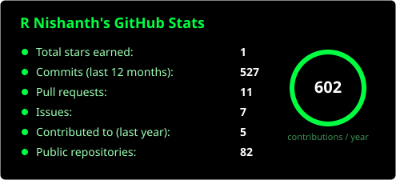
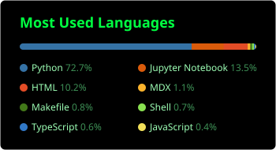
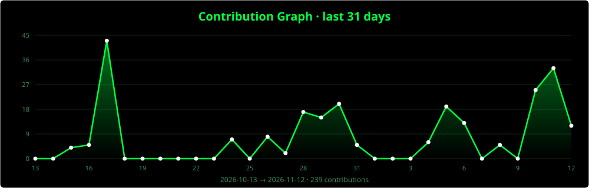

<p align="center">
  
</p>

<h1 align="center">R Nishanth</h1>

<p align="center">
  <a href="https://github.com/Nishanth-nishu">
    
  </a>
</p>

<p align="center">
  <a href="https://www.linkedin.com/in/r-nishanth-/">LinkedIn</a> ·
  <a href="https://nishanth-nishu.github.io/my_protfolio/">Portfolio</a> ·
  <a href="https://github.com/Nishanth-nishu?tab=repositories">Repositories</a>
</p>

---

I build production-grade **agentic AI systems**: multi-agent orchestration, self-healing pipelines, distributed ML infrastructure and RAG-powered assistants.
Background in **distributed systems** (consistent hashing, quorum replication, fault tolerance) and domain work in **healthcare AI, drug discovery and FinTech**.

**Open to:** SDE roles in AI/agent infrastructure · ML engineering & LLMOps · research engineering in agentic systems.

## ⚡ Live from GitHub

_Auto-updated every 6 hours by a GitHub Action._

**Recent activity**

<!--START_SECTION:recent-->
- 🔀 Opened PR [#2796](https://github.com/pydantic/logfire/pull/2796) in [pydantic/logfire](https://github.com/pydantic/logfire) · <sub>2h ago</sub>
<!--END_SECTION:recent-->

**Recently pushed**

<!--START_SECTION:repos-->
| Repository | What it is | Lang | Updated |
|---|---|---|---|
| [**YT_BOTS_AUTOMATION**](https://github.com/Nishanth-nishu/YT_BOTS_AUTOMATION) | For personal use: an AI-powered YouTube Shorts automation bot that transforms dr | Python | 8m ago |
| [**insta-bot**](https://github.com/Nishanth-nishu/insta-bot) | for personal use for automating faceless reels on insta | Python | 1h ago |
| [**lazy-bot-messQR-seller**](https://github.com/Nishanth-nishu/lazy-bot-messQR-seller) | just lazy or sleepy to sell the morning meals, just automated to lsiten the chat | JavaScript | 3h ago |
| [**NEXUS-OS-NA-**](https://github.com/Nishanth-nishu/NEXUS-OS-NA-) | NEXUS OS is an open-source, Debian-based AI server operating environment. | — | 4h ago |
| [**fault-tolerant-pipeline-inference**](https://github.com/Nishanth-nishu/fault-tolerant-pipeline-inference) | Fault-tolerant two-stage pipeline-parallel LLM inference over gRPC. KV-cache-awa | Python | 6d ago |
<!--END_SECTION:repos-->

## 🧠 Selected work

| Project | What it is |
|---|---|
| [**ChainMind**](https://github.com/nishanth-nishu/ChainMind-) | Multi-agent self-healing supply chain platform — ReAct orchestration, hybrid RAG, MCP · A2A · gRPC |
| [**Multi-Agent Healthcare Workflow**](https://github.com/nishanth-nishu/multi-agent-AI-system-for-a-healthcare-workflow) | End-to-end multi-agent system for clinical task automation |
| [**healthcare-GenAI-Guardian**](https://github.com/nishanth-nishu/healthcare-GenAI-Guardian) | Secure RAG assistant for clinical settings with PII masking |
| [**Distributed KV Store**](https://github.com/nishanth-nishu/distributed-kv-store) | Fault-tolerant store with quorum replication & write-ahead logging |
| [**Jepa Diffusion Generation**](https://github.com/nishanth-nishu/Jepa_diffusion_generation) | Geometry-aware molecule generation via JEPA + diffusion |
| [**Smart Document Q&A**](https://github.com/nishanth-nishu/Smart-Document-Q-A-System) | LLM-grounded Q&A over PDFs with source attribution |

<sub>More in [repositories](https://github.com/Nishanth-nishu?tab=repositories).</sub>

## 🛠️ Stack

<p>
  
</p>

LangChain · Hugging Face · MCP · A2A · ReAct · RAG · gRPC · spaCy

## 🏆 Highlights

- 📄 Paper accepted at **ICMED 2025** — *Japanese-to-English Video Dubbing Using BERT and Open Voice*
- 🥈 Runner-up, state-level technical fest — AI healthcare solution (2023)
- 🎤 Presenter, IEEE national-level project expo (2024) · BITS Pilani Hyderabad AI/ML workshop (2024)
- 🌍 Open-source contributions to PyTorch, DeepChem, LangChain

## 📊 Stats

<p align="center">
  
  
</p>

<p align="center">
  
</p>

<p align="center">
  
</p>

```python
class Nishanth:
    """The owl on the night shift."""

    mantra = "Agents that think. Pipelines that heal. Systems that scale."
    fuel   = ["black coffee", "clean commits", "curiosity"]
    vision = "night vision for production incidents"

    def on_call(self):
        while self.bugs:
            self.hunt(self.bugs.pop())      # owls don't sleep on bugs
        self.ship("agentic AI") and self.sleep(hours=0)
```

<p align="center">
  
</p>
