<div align="center">

<!-- Animated wave header -->


<!-- Animated owl banner (upload assets/owl-banner.svg to this repo) -->


<!-- Typing animation -->
<a href="https://github.com/Nishanth-nishu">
  
</a>

<br/>


</div>

---

## 🦉 About Me

I build **production-grade Agentic AI systems** — from multi-agent orchestration and self-healing pipelines to distributed ML infrastructure and RAG-powered assistants.

- 🤖 Focused on **Agentic AI**, **Multi-Agent Systems**, and **LLM Application Engineering**
- 🏗️ Building with **MCP, A2A, gRPC, ReAct, RAG, and hybrid orchestration patterns**
- 🌐 Strong foundation in **Distributed Systems** — consistent hashing, quorum replication, fault tolerance
- 🏥 Domain expertise spanning **Healthcare AI**, **Drug Discovery**, and **FinTech**
- 🔧 Experienced in shipping **microservices, event-driven pipelines, and cloud-native ML systems**
- 💬 Ask me about **Agentic architectures, LLM tool use, distributed systems design, MLOps**

---

## 🌐 Connect with Me

<p>
  <a href="https://www.linkedin.com/in/r-nishanth-/"></a>
  <a href="https://nishanth-nishu.github.io/my_protfolio/"></a>
  <a href="https://github.com/nishanth-nishu"></a>
</p>

---

## 🚀 Featured Projects

### 🧠 Agentic AI & Multi-Agent Systems

| Project | Description | Stack |
|--------|-------------|-------|
| [**ChainMind**](https://github.com/nishanth-nishu/ChainMind-) | Multi-agent self-healing supply chain platform with ReAct orchestration & hybrid RAG | `MCP` · `A2A` · `gRPC` · `Python` |
| [**Multi-Agent Healthcare Workflow**](https://github.com/nishanth-nishu/multi-agent-AI-system-for-a-healthcare-workflow) | End-to-end multi-agent AI system for clinical task automation | `Python` · `LangChain` |
| [**AI Web Search Agent**](https://github.com/nishanth-nishu/-AI-Web-Search-Agent) | LLM agent with external tool integration, source retrieval & synthesis | `Python` · `Tool Use` |
| [**multica Issue Agent**](https://github.com/nishanth-nishu/multica_an_issue_agent) | Managed agent platform — assign tasks, track progress, compound agent skills | `TypeScript` |

### 🏗️ Distributed Systems & MLOps

| Project | Description | Stack |
|--------|-------------|-------|
| [**Distributed KV Core**](https://github.com/nishanth-nishu/Distributed-KV-Core) | Dynamo-inspired KV store with consistent hashing & OOP design | `Python` · `MIT` |
| [**Distributed KV Store**](https://github.com/nishanth-nishu/distributed-kv-store) | Fault-tolerant store with quorum replication & write-ahead logging | `Makefile` · `Python` |
| [**Microservices AI System**](https://github.com/nishanth-nishu/Microservices-AI-System) | Java gateway + Python AI bridge with security & resilience layers | `Java` · `Python` |
| [**Scalable Claims Intelligence**](https://github.com/nishanth-nishu/-Scalable-Claims-Intelligence-) | Distributed ML pipeline for insurance cost prediction & anomaly detection | `Python` · `Big Data` |

### 🔍 RAG, LLMs & AI Applications

| Project | Description | Stack |
|--------|-------------|-------|
| [**healthcare-GenAI-Guardian**](https://github.com/nishanth-nishu/healthcare-GenAI-Guardian) | Secure RAG assistant for clinical environments with PII masking | `Python` · `RAG` · `NLP` |
| [**Smart Document Q&A**](https://github.com/nishanth-nishu/Smart-Document-Q-A-System) | PDF/text ingestion with LLM-grounded Q&A and source attribution | `TypeScript` |
| [**Synergex Med AI Call QA**](https://github.com/nishanth-nishu/The-Synergex-Med-AI-Call-QA-System) | HIPAA-compliant call QA system with agent performance monitoring | `FastAPI` · `Gemini` |
| [**AI Product Recommendation**](https://github.com/nishanth-nishu/AI-Powered-Product-Recommendation-Microservice-with-Gemini-Kafka) | Event-driven recommendation microservice | `FastAPI` · `Kafka` · `Docker` |

### 🔬 AI for Drug Discovery & Healthcare

| Project | Description | Stack |
|--------|-------------|-------|
| [**mol_next_gen**](https://github.com/nishanth-nishu/mol_next_gen) | Graph-based molecular generation | `Python` · `GNN` |
| [**Jepa Diffusion Generation**](https://github.com/nishanth-nishu/Jepa_diffusion_generation) | Geometry-aware molecule generation via JEPA + diffusion models | `Python` · `MIT` |
| [**Pharmacovigilance**](https://github.com/nishanth-nishu/Pharmacovigilance) | Post-market drug surveillance system bridging FDA monitoring | `Jupyter` · `Python` |
| [**GAN AniFace**](https://github.com/nishanth-nishu/GAN_aniface) | GAN experiments on facial datasets | `Python` |

---

## 🛠️ Tech Stack

<div align="center">

### 🤖 Agentic AI & LLM Engineering


### 🔹 Core Languages


### 🔹 ML & Deep Learning


### 🔹 Distributed Systems & Infrastructure


### 🔹 Tools & Ecosystem


</div>

---

## 🧠 What I'm Currently Building

```yaml
name: R Nishanth
focus:
  - "Agentic AI Systems (MCP, A2A, ReAct, Tool-Use)"
  - "Distributed ML Infrastructure & MLOps"
  - "RAG Pipelines & LLM Application Engineering"
  - "Healthcare AI & Computational Chemistry"
open_to:
  - "SDE roles in AI/Agent infrastructure"
  - "ML Engineering & LLMOps"
  - "Research Engineering in Agentic Systems"
hobbies:
  - "Open Source (PyTorch, DeepChem, LangChain)"
  - "Mentoring"
  - "Cooking"
  - "Exploring Emerging AI Architectures"
```

---

## 📊 GitHub Stats

<div align="center">


</div>

---

## 🏆 Achievements

- 📄 Research paper accepted at **ICMED 2025** — *"Japanese-to-English Video Dubbing Using BERT and Open Voice"*
- 🎓 Selected participant in **BITS Pilani Hyderabad AI/ML Workshop** (2024)
- 🥈 **Runner-Up** at State-Level Technical Fest for innovative AI healthcare solution (2023)
- 🎤 **Presenter** at IEEE National-Level Project Expo (2024)
- 🌍 Active **Open Source Contributor** — **PyTorch, DeepChem, LangChain**

---

<div align="center">


</div>
